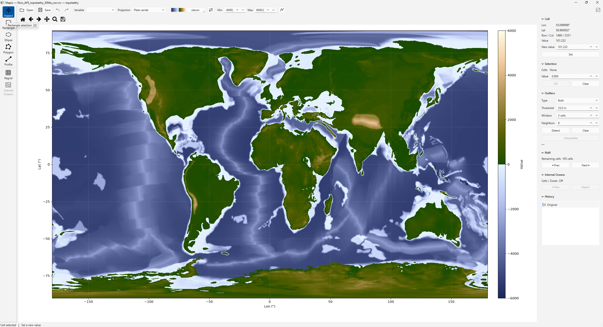
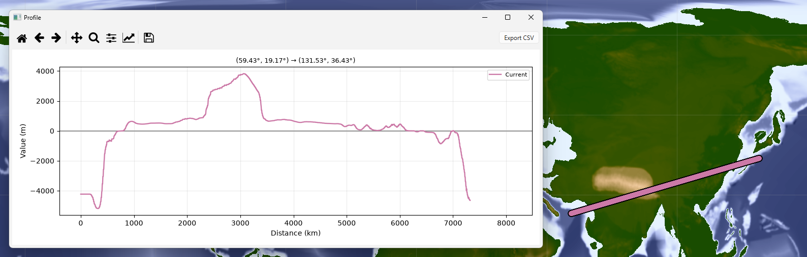
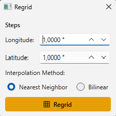

# MAPIX

## Introduction

This initiative was created after identifying a lack of user-friendly
tools for easily editing NetCDF files. MAPIX therefore focuses primarily
on editing and preparing topographic files to generate the boundary
conditions required for simulations with the IPSLCM5A2 climate model.

MAPIX was largely inspired by the work of Wesley Banfield, Anthony
Gramoullé, and other members of the French Deep-Time Paleoclimate
Modelling Group, who developed the [NetCDF Editor App](https://paleoclim-cnrs.github.io/documentation/processing-toolkit/app). This app offers
two modes: one for editing NetCDF files only, and another for preparing
boundary conditions for the IPSLCM5A2 climate model.
MAPIX covers the first two steps of the Multi Page Web App workflow for
editing topographic NetCDF files: regridding files onto a regular grid
and detecting internal oceans. It does not cover the following steps,
and its use stops before the routing stage. MAPIX was developed as a
user-friendly interface to help prepare an initial topographic file for
routing and the other steps required to create boundary conditions.

MAPIX was developed with the help of AI, guided by specific human
instructions. The application consists of a single Python script. The
aim of this interface is to provide a starting point for collaborative
development, so that the source code can be improved and adapted to
users' different needs.
I am making this application available to the community because I am not
a software developer myself. I hope that people with programming skills
will be able to contribute to the project, modify the source code, and
improve the application. Another goal is to reduce the need for repeated
AI prompts to develop individual tools. By turning this application into
a shared and collaborative project, I believe we can avoid creating many
separate tools and help reduce the environmental impact associated with
AI use.

---

## Installation

1.  Create an empty folder on your computer named `MAPIX`.

2.  Download the two files `mapix.py` and `requirements.txt` from the
    MAPIX repository.

3.  Place both files in your `MAPIX` folder.

4.  Open PowerShell and navigate to your `MAPIX` folder. For example:

    ``` powershell
    cd C:\Users\<username>\Documents\MAPIX
    ```

5.  Create a Python virtual environment using Python 3.13.3:

    ``` powershell
    py -3.13 -m venv mapix_env
    ```

6.  Activate the virtual environment:

    ``` powershell
    .\mapix_env\Scripts\Activate.ps1
    ```

7.  Upgrade pip and install the required packages:

    ``` powershell
    python -m pip install --upgrade pip
    python -m pip install -r requirements.txt
    ```

8.  Launch MAPIX:

    ``` powershell
    python mapix.py
    ```
---

## Usage



### Overview of the application

MAPIX provides a graphical interface based on Matplotlib's Qt backend
and PySide6. It allows you to navigate through your NetCDF file and
interact with the topographic data.

-   **Home:** Return to the initial view.
-   **Back / Forward:** Navigate between previous and next views.
-   **Pan:** Move around the map.
-   **Zoom:** Zoom in on a selected area.
-   **Save:** Save the current figure as a PNG image.

### Top toolbar

-   **Open / Save:** Open a NetCDF file and save an edited copy.
-   **Undo / Redo:** Undo or redo the last changes.
-   **Variable:** Select the 2D variable to display.
-   **Projection:** Change the map projection.
-   **Colormap:** Choose a colour palette and reverse its colours.
-   **Min / Max:** Adjust the colour scale limits, or use Auto to fit
    the data range.
-   **Profile Plot:** Reopen the latest profile plot.

The colour palettes are provided by the `cmcrameri` package. They are
[scientific colour maps](https://www.fabiocrameri.ch/colourmaps/) designed by Fabio Crameri and collaborators. Most
of the palettes come from Scientific Colour Maps version 8. Three
additional palettes (`fes9`, `delphi`, and `ston`) have been manually
integrated into MAPIX from version 9, released on 18 November 2026.



### Left panel -- Editing tools

-   **Inspect:** Click on a cell to view its coordinates and value.
-   **Rectangle / Ellipse / Polygon:** Select an area of the map.
-   **Profile:** Draw a line between two points to display a topographic
    profile. The profile shows the elevation along the line and can be
    exported as a CSV file.
-   **Regrid:** Create a new regular longitude/latitude grid with a
    chosen grid spacing and interpolation method.
-   **Internal Oceans:** Highlight negative areas that are disconnected
    from the main ocean. This tool is available only after regridding.



### Right panel -- Editing options

-   **Cell:** Displays the coordinates and value of the selected cell,
    and allows you to change its value.
-   **Selection:** Displays the number of selected cells and allows you
    to fill the selected area with a new value.
-   **Outliers:** Detect unusually high or low values within a selected
    area. You can choose to detect peaks, pits, or both, and adjust the
    detection settings. The detected cells can then be interpolated
    using nearby values.
-   **NaN:** Displays the number of missing values (NaN) and allows you
    to navigate between them. Missing values must be corrected before
    regridding.
-   **Internal Oceans:** Displays the detected areas and allows you to
    navigate between them.
-   **History:** Displays the list of editing steps. Click on a previous
    step to restore the corresponding state of the data.

---
